<p align="center">
  
</p>

<h1 align="center">💳 Detección de Fraude en Tarjetas de Crédito</h1>

<p align="center">
  <b>Machine Learning + inferencia estadística sobre dos bases de datos complementarias</b><br>
  <i>Datos reales anonimizados (PCA) · Datos simulados con variables de negocio</i>
</p>

<p align="center">
  
  
  
  
  
  
</p>

---

## 📌 Contenido

- [Motivación](#-motivación)
- [Las dos bases de datos](#-las-dos-bases-de-datos)
- [Resultados principales](#-resultados-principales)
- [Metodología](#-metodología)
- [Modelo matemático](#-modelo-matemático)
- [Inferencia estadística](#-inferencia-estadística)
- [Galería de gráficas](#-galería-de-gráficas)
- [Cómo funciona el modelo](#-cómo-funciona-el-modelo)
- [Guardar y usar el modelo](#-guardar-y-usar-el-modelo)
- [Cómo ejecutarlo](#-cómo-ejecutarlo)
- [Estructura del repositorio](#-estructura-del-repositorio)
- [Referencias](#-referencias)

---

## 🎯 Motivación


El fraude con tarjetas cuesta a la industria más de **30 mil millones de dólares al año**. El reto técnico no es solo
clasificar: los fraudes son **menos del 1 %** de las transacciones, por lo que un modelo que diga
"todo es legítimo" tendría 99.8 % de exactitud y sería completamente inútil.

Este proyecto unifica en **un solo script** el trabajo de varios notebooks de análisis previo y lo aplica a
**dos bases de datos que se complementan**:

- una con datos **reales** pero anonimizados (no sabemos qué significa cada variable), y
- otra **simulada** donde sí tenemos el contexto (comercio, hora, ubicación, cliente) y podemos construir variables con sentido de negocio.

<br clear="right"/>

---

## 🗂 Las dos bases de datos

| | 🇪🇺 **Europea** (`creditcard.csv`) | 🇺🇸 **Sparkov** (`fraudTrain/Test.csv`) |
|---|---|---|
| Origen | Tarjetahabientes europeos, sept. 2013 (ULB / Worldline) | Simulador Sparkov, 2019-2020 |
| Transacciones | 284,807 (283,726 sin duplicados) | 1,852,394 |
| Fraudes | 473 → **0.167 %** | 9,651 → **0.521 %** |
| Variables | `V1…V28` (PCA), `Time`, `Amount` | Comercio, categoría, monto, ubicación, fecha de nacimiento, etc. |
| Partición | Estratificada 60/20/20 | **Temporal**: train 2019-2020 / test 2020 (como viene) |
| Qué aporta | Mide la capacidad pura de los modelos | Permite *feature engineering* e interpretación |

---

## 🏆 Resultados principales

Métricas sobre el **conjunto de prueba** (nunca visto en el entrenamiento ni en la elección del umbral).
El modelo principal se selecciona por **PR-AUC**; el umbral operativo de cada modelo se elige en validación
maximizando F1. Por eso el modelo con mayor PR-AUC no necesariamente es el de mayor F1.

### Base Europea

| Modelo | PR-AUC | ROC-AUC | F1 | Precisión | Recall | MCC |
|---|:-:|:-:|:-:|:-:|:-:|:-:|
| **LightGBM** | **0.833** | 0.969 | **0.859** | 0.927 | **0.800** | **0.861** |
| XGBoost | 0.828 | 0.973 | 0.852 | **0.973** | 0.758 | 0.859 |
| Ensamble (promedio) | 0.826 | 0.973 | 0.845 | 0.973 | 0.747 | 0.852 |
| Random Forest | 0.814 | 0.958 | 0.835 | 0.947 | 0.747 | 0.841 |
| Regresión logística | 0.676 | 0.963 | 0.796 | 0.837 | 0.758 | 0.796 |

> De 95 fraudes en el test, LightGBM detecta **76** con solo **6 falsas alarmas** entre 56,651 transacciones legítimas.

### Base Sparkov

| Modelo | PR-AUC | ROC-AUC | F1 | Precisión | Recall | MCC |
|---|:-:|:-:|:-:|:-:|:-:|:-:|
| **XGBoost** | **0.973** | **0.999** | 0.932 | 0.938 | 0.925 | 0.931 |
| LightGBM | 0.972 | 0.999 | 0.931 | **0.945** | 0.918 | 0.931 |
| Ensamble (promedio) | 0.968 | 0.998 | **0.933** | 0.941 | **0.926** | **0.933** |
| Random Forest | 0.943 | 0.997 | 0.895 | 0.915 | 0.877 | 0.895 |
| Regresión logística | 0.335 | 0.983 | 0.495 | 0.398 | 0.656 | 0.508 |

> XGBoost detecta **1,985 de 2,145 fraudes (92.5 %)** con 132 falsos positivos entre más de medio millón de transacciones.

**Intervalos de confianza al 95 % (bootstrap estratificado, 500 réplicas):**

| Base | Mejor modelo | PR-AUC | ROC-AUC | F1 |
|---|---|---|---|---|
| Europea | LightGBM | [0.759, 0.899] | [0.943, 0.989] | [0.798, 0.910] |
| Sparkov | XGBoost | [0.968, 0.978] | [0.999, 1.000] | [0.924, 0.940] |

<p align="center">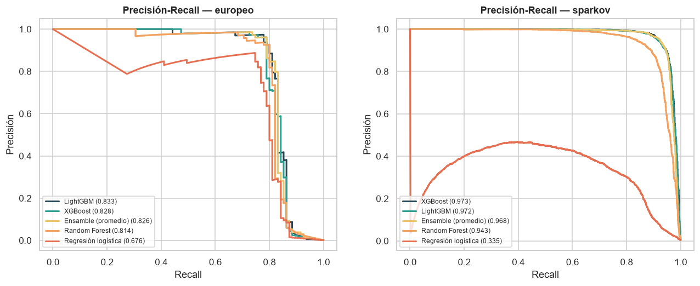</p>

**Lectura conjunta de ambas bases**

1. Los modelos de *boosting* (XGBoost / LightGBM) dominan la PR-AUC en las dos bases. McNemar exacto compara sus decisiones al umbral elegido; un resultado no significativo solo indica que estos datos no aportan evidencia suficiente de una diferencia en errores pareados, no que los modelos sean equivalentes.
2. La regresión logística tiene un ROC-AUC alto pero una PR-AUC baja: es el ejemplo clásico de por qué **el ROC-AUC engaña con clases desbalanceadas**.
3. En Sparkov las variables construidas (monto relativo al historial de la tarjeta, gasto en 24 h, hora) llevan el desempeño a PR-AUC ≈ 0.97: **el contexto del comportamiento del cliente vale más que el algoritmo**.
4. El intervalo de la base europea es mucho más ancho porque el test solo tiene 95 fraudes — la incertidumbre importa al reportar resultados.

---

## 🔬 Metodología

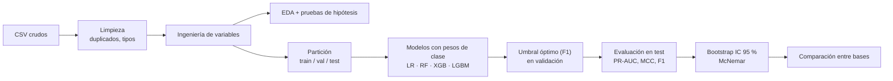

**Ingeniería de variables (Sparkov)** — todas calculadas solo con información **pasada** para evitar fuga de datos:

| Variable | Descripción |
|---|---|
| `distancia_km` | Distancia haversine entre el cliente y el comercio |
| `edad` | Edad del tarjetahabiente al momento de la compra |
| `hora`, `dia_semana`, `madrugada` | Patrones temporales |
| `log_seg_desde_anterior` | Tiempo desde la transacción previa de la misma tarjeta |
| `ratio_monto_hist` | Monto actual / promedio histórico de la tarjeta |
| `trans_24h`, `monto_24h` | Número de compras y gasto en las últimas 24 h |
| `cat_*` | Categoría del comercio (one-hot) |

**Base europea:** `log(1 + Amount)` y la hora del día codificada de forma cíclica (`sin`, `cos`) a partir de `Time`.

**Manejo del desbalance:** pesos de clase / `scale_pos_weight` en lugar de sobremuestreo sintético (SMOTE), y submuestreo
de la clase mayoritaria solo para Random Forest en la base grande (por tiempo de cómputo).

---

## 📐 Modelo matemático

### Regresión logística (línea base)

La probabilidad de fraude se modela como

$$
P(y=1 \mid \mathbf{x}) = \sigma(\mathbf{w}^\top \mathbf{x} + b) = \frac{1}{1 + e^{-(\mathbf{w}^\top \mathbf{x} + b)}}
$$

y los parámetros se estiman minimizando la entropía cruzada **ponderada** con regularización L2:

$$
\mathcal{L}(\mathbf{w}) = -\sum_{i=1}^{n} \alpha_{y_i}\Big[y_i \log \hat p_i + (1-y_i)\log(1-\hat p_i)\Big] + \frac{1}{2C}\lVert \mathbf{w} \rVert_2^2,
\qquad \alpha_k = \frac{n}{2\,n_k}
$$

donde $\alpha_k$ compensa que la clase fraude tiene muy pocas observaciones.

### Gradient Boosting (XGBoost / LightGBM)

El modelo es una suma aditiva de $K$ árboles de regresión $f_k$:

$$
\hat y_i = \sigma\Big(\sum_{k=1}^{K} f_k(\mathbf{x}_i)\Big), \qquad f_k \in \mathcal{F}
$$

En cada iteración $t$ se agrega el árbol que minimiza una aproximación de Taylor de segundo orden de la pérdida regularizada:

$$
\mathcal{L}^{(t)} \approx \sum_{i=1}^{n}\Big[g_i f_t(\mathbf{x}_i) + \tfrac{1}{2} h_i f_t^2(\mathbf{x}_i)\Big] + \gamma T + \tfrac{1}{2}\lambda \sum_{j=1}^{T} w_j^2
$$

con $g_i$ y $h_i$ el gradiente y el hessiano de la log-pérdida, $T$ el número de hojas y $w_j$ sus pesos. El peso de cada
fraude se multiplica por $\sqrt{n_{0}/n_{1}}$ (`scale_pos_weight`), un punto intermedio entre no ponderar y el balance completo.

### Random Forest

Promedio de $B$ árboles entrenados con muestras bootstrap y subconjuntos aleatorios de variables, lo que reduce la varianza:

$$
\hat p(\mathbf{x}) = \frac{1}{B}\sum_{b=1}^{B} T_b(\mathbf{x})
$$

### Elección del umbral

En lugar de usar 0.5, el umbral $\tau^*$ se elige en el conjunto de **validación** maximizando $F_1$:

$$
\tau^* = \arg\max_{\tau}\; \frac{2\,\text{Prec}(\tau)\,\text{Rec}(\tau)}{\text{Prec}(\tau) + \text{Rec}(\tau)}
$$

### Métricas

| Métrica | Fórmula | Por qué importa |
|---|---|---|
| Precisión | $\frac{TP}{TP+FP}$ | Costo de falsas alarmas (clientes molestos) |
| Recall | $\frac{TP}{TP+FN}$ | Fraudes que se escapan (pérdida directa) |
| PR-AUC | $\sum_n (R_n - R_{n-1}) P_n$ | **Métrica principal**: no se infla con los verdaderos negativos |
| Lift PR-AUC | $\frac{\text{PR-AUC}}{\text{prevalencia}}$ | Mejora sobre un clasificador aleatorio; permite contextualizar bases con tasas de fraude distintas |
| F2 | $\frac{5PR}{4P+R}$ | Variante de F1 que da el doble de peso al recall |
| MCC | $\frac{TP\cdot TN - FP\cdot FN}{\sqrt{(TP+FP)(TP+FN)(TN+FP)(TN+FN)}}$ | Correlación entre predicción y realidad, robusta al desbalance |
| FPR por 1000 | $1000\frac{FP}{FP+TN}$ | Falsas alarmas esperadas por cada 1,000 operaciones legítimas |
| Alertas por 1000 | $1000\frac{TP+FP}{N}$ | Carga operativa que recibiría el equipo de revisión |

---

## 📊 Inferencia estadística

| Prueba | Hipótesis nula $H_0$ | Europea | Sparkov |
|---|---|---|---|
| **Mann-Whitney U** (monto) | El monto de fraudes y legítimas tiene la misma distribución | p = 2.7×10⁻⁵, $r_{rb}$ = −0.11 | p ≈ 0, $r_{rb}$ = 0.67 |
| **χ² de independencia** (hora) | La hora es independiente del fraude | χ² = 548, p ≈ 10⁻¹⁰¹, V = 0.04 | χ² = 23,393, p ≈ 0, V = 0.11 |
| **χ² de independencia** (categoría) | La categoría es independiente del fraude | — | χ² = 8,329, p ≈ 0, V = 0.07 |
| **Kolmogorov-Smirnov** | Componentes PCA iguales en ambas clases | Se rechaza $H_0$ en los componentes más discriminantes (ver gráfica de distribuciones) | — |
| **McNemar exacto** | Los dos mejores modelos tienen la misma probabilidad de ganar un caso discordante | Ver `reporte.json` | Ver `reporte.json` |

- **Mann-Whitney** se usa porque los montos están muy sesgados (no normales). Dato interesante: en la base europea los fraudes tienen una mediana **menor** (9.8 vs 22 €, "pruebas" con montos pequeños), mientras que en Sparkov es **mucho mayor** (390 vs 47 USD).
- Con muestras tan grandes cualquier diferencia puede resultar "significativa", por eso se reporta el **tamaño del efecto** (correlación biserial de rangos y V de Cramér), no solo el p-valor. En $r_{rb}$, el signo positivo significa que el monto tiende a ser mayor en fraude y el negativo que tiende a ser menor.
- Los **intervalos de confianza bootstrap** se obtienen remuestreando positivos y negativos por separado, con reemplazo, 500 veces. Así cada réplica conserva la prevalencia observada:

$$
IC_{95\%} = \big[\hat\theta^*_{(2.5)},\; \hat\theta^*_{(97.5)}\big]
$$

- **McNemar exacto** compara dos clasificadores sobre las mismas observaciones mediante una prueba binomial sobre los casos discordantes. El reporte incluye cuántos casos acierta exclusivamente cada modelo, además del p-valor.

---

## 🖼 Galería de gráficas

<details open>
<summary><b>🇪🇺 Base europea</b></summary>

| | |
|---|---|
| 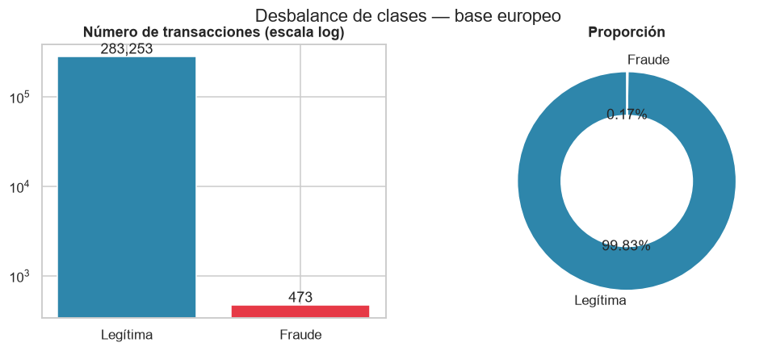 | 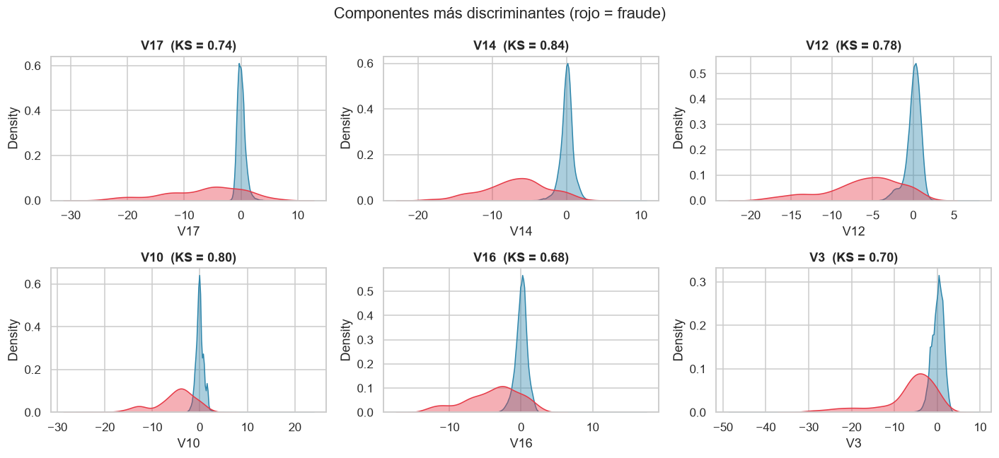 |
| 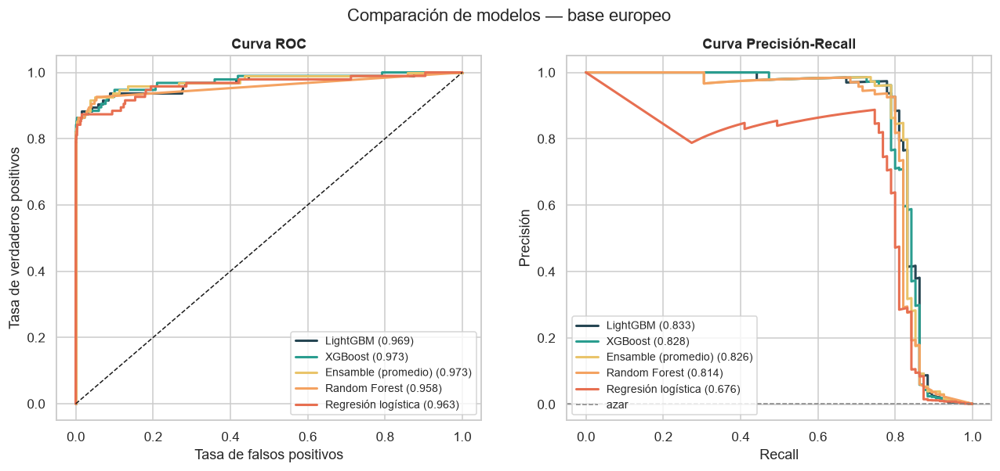 | 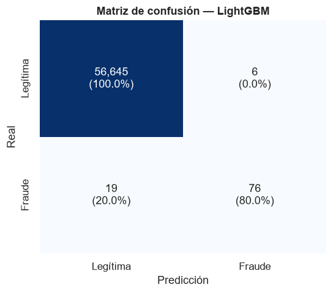 |
| 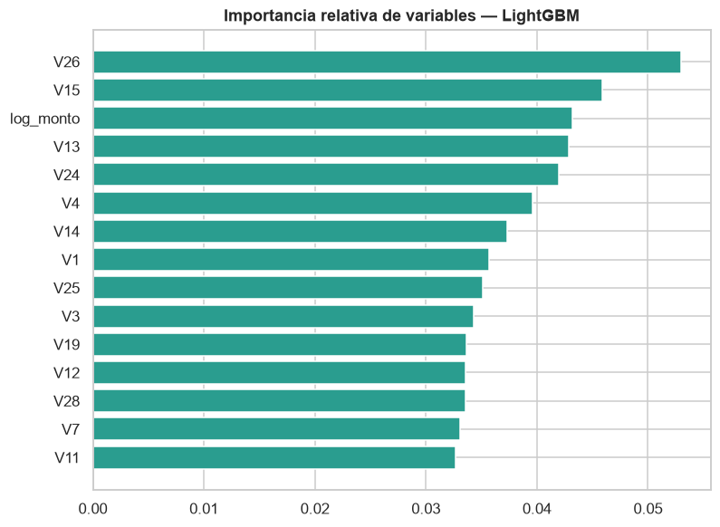 | 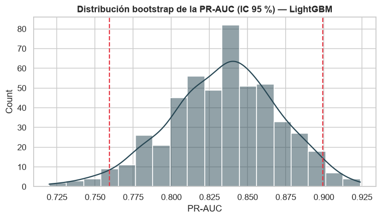 |

</details>

<details open>
<summary><b>🇺🇸 Base Sparkov</b></summary>

| | |
|---|---|
| 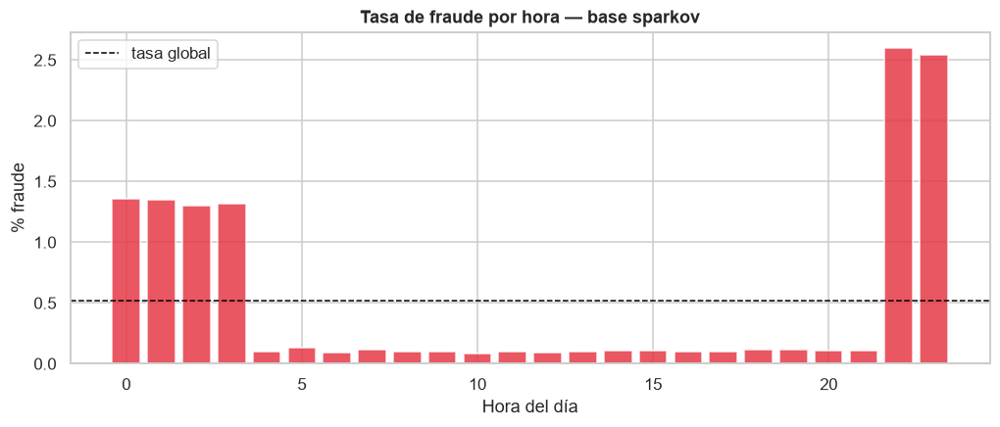 | 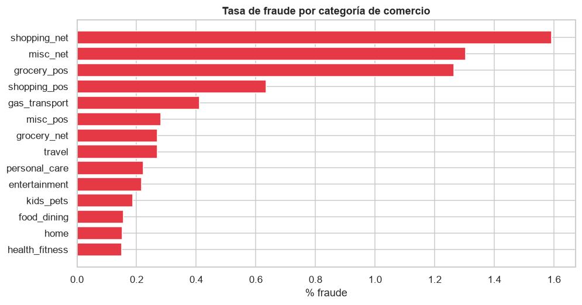 |
| 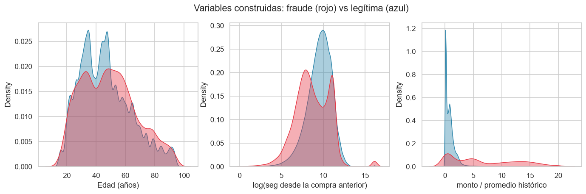 | 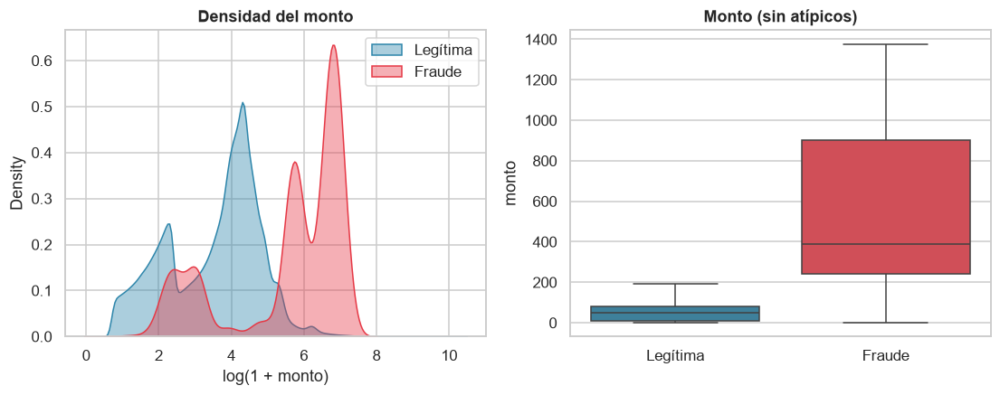 |
| 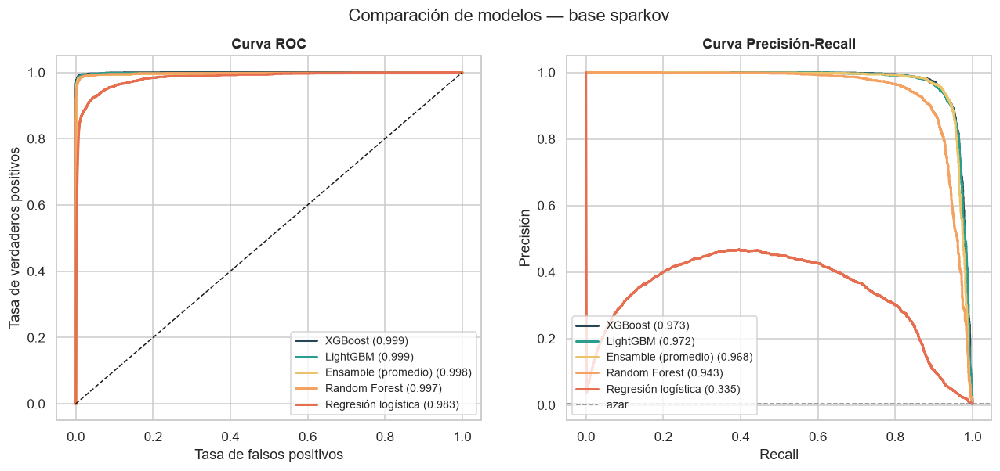 | 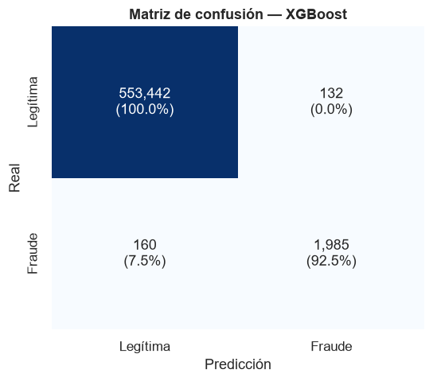 |
| 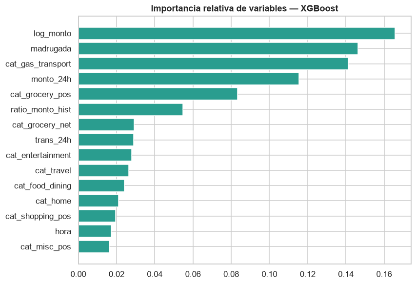 | 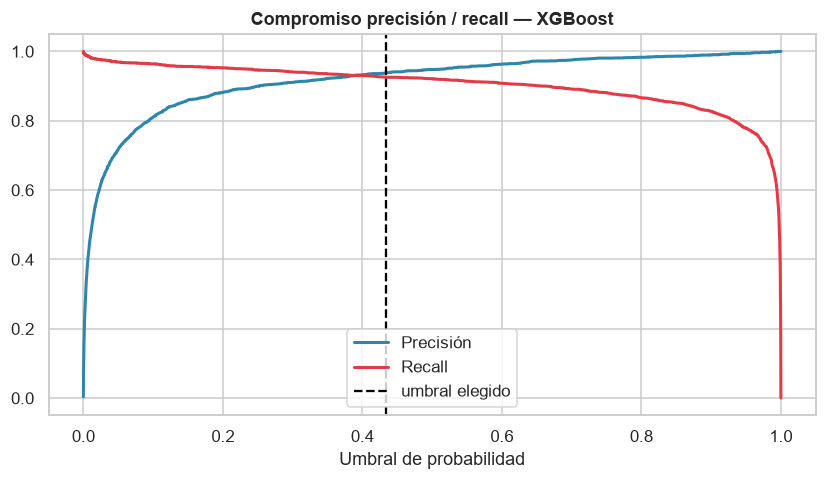 |

</details>

<p align="center">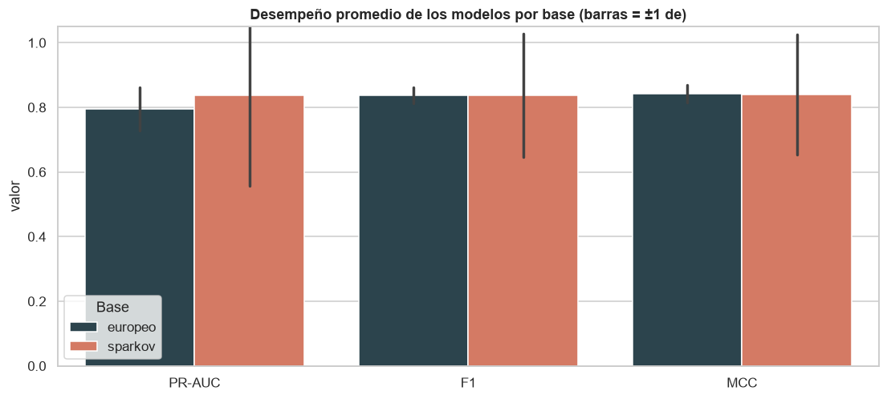</p>

---

## 🧠 Cómo funciona el modelo

Sí se entrena **inteligencia artificial**, concretamente modelos de *machine learning* supervisado. Cada fila histórica
incluye variables de una transacción y una etiqueta: `0` para legítima y `1` para fraude. El flujo es:

1. Se limpian los datos y se construyen variables como hora, distancia, monto relativo e historial de 24 horas.
2. El entrenamiento ajusta los parámetros de Regresión Logística, Random Forest, XGBoost y LightGBM.
3. La validación elige el umbral que maximiza F1; el test permanece intacto hasta la evaluación final.
4. El modelo ganador por PR-AUC recibe una transacción nueva y devuelve una **probabilidad de fraude**.
5. Si esa probabilidad supera el umbral guardado, se genera una alerta.

XGBoost y LightGBM construyen secuencias de árboles que aprenden combinaciones y reglas a partir de los patrones
observados. Esto es clasificación tabular, no un modelo generativo como ChatGPT.

---

## 💾 Guardar y usar el modelo

Antes, los modelos solo existían en memoria durante la ejecución; por eso no aparecía un `.h5` o `.joblib`.
`.h5` suele usarse para redes neuronales de Keras/TensorFlow, pero este proyecto utiliza scikit-learn, XGBoost y
LightGBM. El formato principal ahora es `.joblib` porque puede conservar en un solo paquete:

- el estimador o los miembros del ensamble;
- el orden exacto de las variables;
- el umbral de clasificación;
- el escalador, cuando el modelo lo necesita;
- las versiones y métricas del entrenamiento.

La ejecución normal crea `modelos/europeo_mejor_modelo.joblib` y
`modelos/sparkov_mejor_modelo.joblib`, además del formato nativo del booster ganador y un JSON de metadatos.

Para predecir con la base europea:

```bash
python predict_fraud.py \
  --model modelos/europeo_mejor_modelo.joblib \
  --input nuevas_transacciones.csv \
  --output predicciones.csv
```

El CSV europeo puede contener las columnas originales `Time`, `Amount` y `V1..V28`; el script reconstruye las
variables derivadas. En Sparkov, las variables de historial dependen de transacciones anteriores de cada tarjeta.
Por eso una integración productiva debe mantener ese estado temporal; no es correcto predecir una fila aislada
inventando su historial.

Los binarios entrenados se excluyen de GitHub porque pueden ser grandes y dependen de las versiones instaladas.
El código, el formato y las instrucciones sí quedan versionados. No cargues archivos `.joblib` de fuentes
desconocidas, pues este formato utiliza serialización tipo pickle.

---

## ⚙️ Cómo ejecutarlo

```bash
# 1. Clonar
git clone https://github.com/<tu-usuario>/credit-card-fraud-detection.git
cd credit-card-fraud-detection

# 2. Entorno e instalación
python -m venv .venv
.venv\Scripts\activate          # Windows  (Linux/Mac: source .venv/bin/activate)
pip install -r requirements.txt

# 3. Descargar las bases en data/  (ver data/README.md)

# 4. Ejecutar
python fraud_detection.py --dataset ambas            # análisis + comparación + modelos guardados
python fraud_detection.py --dataset europeo
python fraud_detection.py --dataset sparkov
python fraud_detection.py --dataset ambas --rapido   # muestra reducida para probar
```

| Argumento | Default | Descripción |
|---|---|---|
| `--dataset` | `ambas` | `europeo`, `sparkov` o `ambas` |
| `--data-dir` | `data` | Carpeta con los CSV (busca también en subcarpetas) |
| `--out-dir` | `resultados` | Dónde se guardan gráficas, métricas y `reporte.json` |
| `--model-dir` | `modelos` | Dónde se guardan `.joblib`, metadatos y boosters nativos |
| `--no-guardar-modelo` | — | Ejecuta el análisis sin exportar modelos |
| `--rapido` | — | Submuestra para pruebas rápidas |

⏱ La corrida completa tarda ~20 minutos en una PC de escritorio (la base Sparkov tiene 1.8 M de filas).

---

## 📁 Estructura del repositorio

```
credit-card-fraud-detection/
├── .github/workflows/       # pruebas automáticas en GitHub Actions
├── fraud_detection.py        # entrenamiento, evaluación y exportación
├── predict_fraud.py          # inferencia con un modelo ya entrenado
├── requirements.txt
├── requirements-dev.txt
├── LICENSE
├── data/
│   └── README.md             # instrucciones para descargar las bases (no se suben por tamaño)
├── modelos/
│   └── README.md             # formato y regeneración de artefactos
├── images/                   # imágenes del README
├── tests/                    # pruebas unitarias de métricas
└── resultados/
    ├── europeo/              # 11 gráficas + metricas_modelos.csv
    ├── sparkov/              # 11 gráficas + metricas_modelos.csv
    ├── comparacion_bases.csv
    ├── comparacion_curvas_pr.png
    ├── comparacion_metricas.png
    ├── reporte.json          # pruebas estadísticas, IC y mejor modelo por base
    └── log_ejecucion.txt
```

---

## 📚 Referencias

- Dal Pozzolo, A., Caelen, O., Johnson, R. A., & Bontempi, G. (2015). *Calibrating Probability with Undersampling for Unbalanced Classification*. IEEE CIDM.
- Dal Pozzolo, A. et al. (2018). *Credit card fraud detection: a realistic modeling and a novel learning strategy*. IEEE TNNLS, 29(8).
- Chen, T., & Guestrin, C. (2016). *XGBoost: A Scalable Tree Boosting System*. KDD.
- Ke, G. et al. (2017). *LightGBM: A Highly Efficient Gradient Boosting Decision Tree*. NeurIPS.
- Saito, T., & Rehmsmeier, M. (2015). *The Precision-Recall Plot Is More Informative than the ROC Plot When Evaluating Binary Classifiers on Imbalanced Datasets*. PLoS ONE.
- Le Borgne, Y.-A., & Bontempi, G. *Reproducible Machine Learning for Credit Card Fraud Detection – Practical Handbook*.
- Datos: [Kaggle – Credit Card Fraud (ULB)](https://www.kaggle.com/datasets/mlg-ulb/creditcardfraud) · [Kaggle – Sparkov Fraud Detection](https://www.kaggle.com/datasets/kartik2112/fraud-detection)

---

<p align="center">
  Hecho con ☕ y Python · Si te sirvió, deja una ⭐
</p>
